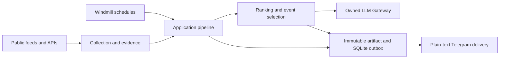

# AI Dash architecture

Reviewed 25 November 2026. AI Dash owns AI-news acquisition, editorial selection,
private report artifacts and Telegram delivery. Windmill schedules and executes
jobs. A separately deployed project-owned LLM Gateway owns provider execution,
credentials, accounting and recovery. There is no application web dashboard or
inbound application API.

## Execution and responsibilities

`cli.py` validates source/report configuration and composes adapters. `reports.py`
selects each report's sources and policies; `cadence.py` derives the preceding
scheduled interval plus overlap in its configured timezone. Collection produces
strict `Item` and `Coverage` records. Article hydration enriches bounded evidence
and verifies linked publication dates without inventing missing dates. Reddit
retains authenticated discussion/crosspost text and hydrates external primary
links without changing the discussion identity or submission timestamp. Its own
editorial prompt admits worthwhile community discussion and attributed claims;
it does not require every post to independently establish a scientific result.

Model-backed reports deduplicate recent/history items, require evidence, evaluate
bounded candidate batches, apply deterministic impact gates, consolidate events,
apply caps and summarize only finalists. Schema/ID checks reject missing or
invented candidate slots. The YouTube branch lists dated uploads newest first
without hydration or LLM inference; it deliberately ignores delivery history to
show the rolling window again.

`pipeline.run` holds an exclusive process lock, discards old unsent outbox entries,
checks Telegram posting permission and builds a fresh artifact. Persistence writes
and fsyncs an immutable JSON file before inserting the edition/outbox in SQLite.
Delivery only follows persistence. A failed send discards its unsent parts and
fails the run; the next run collects again. Date windows, scores, coverage,
selection reasons and model traces remain in private artifacts/checkpoints.

## State and ownership

| State | Owner and invariant |
| --- | --- |
| Source/report/prompt files | Versioned application policy; no credential values |
| SQLite `editions` and `outbox` | Private state; WAL/full synchronization; delivery status retained |
| JSON artifacts | Exclusive-create immutable output; never used as a public data feed automatically |
| Collection checkpoints | Replaceable private diagnostics, including failed selection evidence |
| Gateway receipts/ledger | Independent gateway deployment; never reset to regain allowance |
| Windmill database/volumes/profile | Application-owned scheduling and operation state |
| Telegram and Reddit credentials | Independent private file mounts; not provider credentials |

An artifact file can survive a subsequent failed SQLite insert as an orphan; file
and database writes are not a distributed transaction. The lock and SQLite model
support a single writer/instance, not distributed active-active operation.

## Trust and network boundaries

All external content and model output are untrusted data. Models return structured
decisions and text; they do not execute shell commands or acquire authority to
read credentials. Pydantic/slot checks constrain structure, while deterministic
policy constrains admission. These do not establish factual truth or immunity to
prompt injection that changes editorial judgment.

Public-source fetching pins checked global IPs and validates redirects, preserving
Host and TLS identity. It rejects credentials in fetch URLs, private/mixed DNS
answers, nonstandard ports and compressed response bodies; streaming bounds limit
source/article evidence. This transport carries no provider, Telegram or Reddit
credentials. Authenticated service clients retain fixed-service boundaries.
Telegram errors omit bot-token URLs, and HTTP client logs are reduced at the CLI.

Windmill runs the application worker as root in the current image. It mounts only
needed application state and secrets, but this is not a general sandbox for
untrusted jobs or multi-tenant use. The gateway is an independent service boundary;
separate upstream keys are needed for independent revocation/billing.

## Constraints and remaining risks

Nitter and public publishers can fail, truncate feeds, change layouts or serve
misleading material. Coverage records expose gaps; they do not prove exhaustive
collection. Ranking is subjective and does not independently fact-check sources.
There is no end-user UI, hosted multi-user service or built-in feedback loop.

Exactly-once Telegram delivery is impossible across a lost acknowledgement. An
uncertain send is retained as `discarded_uncertain`; some stories may already have
reached Telegram. History currently reserves every story of an edition with at
least one acknowledged part, so an unsent part of a partial edition can suppress
its stories until the history window expires. This behavior remains explicit and
is not a claim of per-story delivery recovery.

Gateway recovery uses stable run/request identities. Only explicit pre-dispatch
input-limit rejection permits ranking/summary batch splitting. Unknown provider
outcomes retain their identity and are not treated as permission to spend again.
